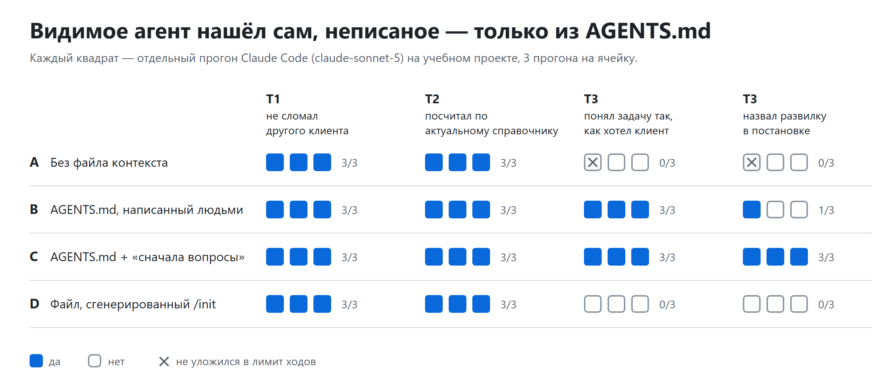

# Неписаные правила и ИИ-ассистент: демо-проект и эксперимент

Материалы к статье «Ваш ИИ-ассистент не проходил онбординг» (ССЫЛКА_НА_СТАТЬЮ).

Вопрос эксперимента: помогает ли ИИ-ассистенту короткий файл с неписаными правилами проекта (`AGENTS.md`) и просьба сначала задать вопросы, если задача требует знания, которого нет в коде?

## Коротко о результатах



36 прогонов Claude Code 2.1.280 (claude-sonnet-5): 3 задачи × 4 условия × 3 повтора.

- **Видимое агент находит сам.** Первые две задачи решены во всех условиях, включая условие без файла контекста. Подсказки в небольшом проекте лежат на виду.
- **Неписаное — нет.** В третьей задаче (противоречивая постановка) без нашего `AGENTS.md` агент 6 раз из 6 молча выбрал не то прочтение, которого хотел клиент. С файлом — 6 раз из 6 то, которого хотел.
- **Вопросы стоят денег.** Явно назвать противоречие агент стабильно смог только при задаче «сначала вопросы» (3 из 3), но это условие самое дорогое во всех задачах.

Это наблюдения на маленьком синтетическом проекте, а не статистика. Ограничения и всё, чего из результатов не следует, описаны в [протоколе](experiment/PROTOCOL.md).

## Что в репозитории

| Путь | Что там |
|---|---|
| `project/` | учебный проект **fitstat**: отчёты для сетей фитнес-клубов, Python без зависимостей, с заложенными «неписаными правилами» |
| `experiment/PROTOCOL.md` | методика, метрики и ожидания, записанные до запуска, и все изменения протокола с датами и причинами |
| `experiment/tasks/` | тексты задач: обычные и по шаблону «сначала вопросы», плюс скрытые факты для «тимлида» |
| `experiment/contexts/` | файлы контекста: `human/` — наш `AGENTS.md` (условия B и C), `generated/` — файл от `/init` (условие D) и транскрипт его генерации |
| `experiment/hidden/` | скрытые проверки и эталонные расчёты прямо по CSV; агент их не видел |
| `experiment/results/` | все 36 прогонов: транскрипты (`stream-json`), диффы, результаты проверок, метаданные |
| `experiment/results/labels*.csv`, `agreement.md` | ручная разметка третьей задачи двумя разметчиками и их согласие; `labels_T3.md` — то, что видели разметчики |
| `experiment/results/_failed/` | прогоны, упавшие по техническим причинам (сеть, лимиты подписки); в результаты не входят |
| `experiment/pilot_2026-10-10/` | пилотный запуск, исключён из данных (причины — в протоколе) |
| `experiment/*.py` | генерация данных, прогоны, подсчёт, самопроверка скрытых тестов |

## Как повторить

Нужны Python 3.11+, git и Claude Code CLI в PATH (`claude --version`).

```bash
# 1. Проверить, что скрытые проверки отличают правильные решения от ошибочных (без вызовов модели)
python experiment/selftest.py

# 2. Один раз сгенерировать файл контекста для условия D
python experiment/run.py prepare-d

# 3. Прогоны (уже выполненные пропускаются, прерванный запуск можно продолжить)
python experiment/run.py run --repeats 3

# 4. Сводка; для третьей задачи нужна ручная разметка (results/labels_todo.md -> results/labels.csv)
python experiment/score.py
```

Для новых прогонов перенесите или удалите текущую папку `experiment/results/`. Иначе уже выполненные прогоны будут пропущены.

Данные синтетические и детерминированные: `python experiment/gen_data.py` воспроизводит `project/raw/` байт в байт. Полный запуск занимает около двух часов и стоит около $20 по ценам API, как их считает Claude Code.

## Примечания

- В транскриптах заменены имя пользователя в локальных путях и часовой пояс в текстах ошибок. На результаты это не влияет.
- В транскриптах видны служебные данные окружения (список инструментов, путь к сокету). Личной информации в них нет.
